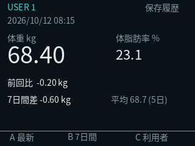
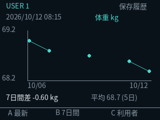

# M5GO saved measurement display

Optional display package and a separate read-only SelfCare bridge. The deployed
Bluetooth route, one-hour automatic-sync suppression, pairing and keys are unchanged.
This is prepared software, **not an OTA deployment or hardware acceptance result**.

## Screens

- **A: 最新** — latest saved weight/body fat, measurement time and weight change
  from the immediately previous measurement.
- **B: 7日間** — switches between weight and body-fat graphs. Seven calendar days
  including today in `Asia/Tokyo`. Each day uses its last measurement. Missing days
  are gaps; missing body-fat values never become zero or borrow another reading.
- **C: 利用者** — cycles the explicitly configured profiles (1–4). Labels are
  short ASCII aliases, for example `USER 1`; arbitrary Japanese names are not in
  the compact font. Users' histories are never combined.
- **7日間差** is last minus first available daily value within the window. It is
  `--` with fewer than two measured days. **平均** is the mean of those daily-last
  values, with the number of measured days shown. Fat changes use percentage points.
  These are arithmetic summaries, not health assessments.
- No history: `測定なし`. No bridge update for over three minutes: `更新停止`,
  while retaining the measurement timestamp and last good data. After reboot the
  screen waits for a fresh snapshot; health data is not persisted on the M5GO.

Previews use fabricated measurements and the real C++ drawing commands; physical
LCD orientation, colors, font baselines and button operation still need checking.




## Data path

`esp_display_bridge.py` reads only SelfCare `GET /api/users` and `GET /api/records`.
After SelfCare saves a successful sync, the next poll (normally within 60 seconds)
pushes the latest result plus seven daily points through ESPHome's existing encrypted
Native API. USB syncs and corrected/imported records are reflected as well.

The bridge uses an ordinary API client, **never subscribes to Bluetooth advertisements
or makes GATT calls**. It runs separately from the radio worker. It cannot create jobs,
register a device, alter keys or bypass the one-hour gate. A rejected snapshot or lost
ACK is retried only at the next display poll. It never retries the scale sync.

Profiles must be explicit. Unknown users, mismatched user/kind, malformed values,
partial/oversized weekly history and incompatible firmware fail closed. Payloads
are at most 4096 bytes. Logs contain no measurements, database IDs, user names,
addresses or keys; there is no disk cache. The optional container has read-only
mounts/filesystem, no capabilities and no Bluetooth device access.

## Firmware preparation

**Use the exact BLE base that is already accepted for the target.** During the
PR #36 experiment that includes `known_bond_security` and its custom controller
diagnostics. The older `main` base does not contain that experiment: do not install
it over the device as a side effect of adding the screen.

In a private build directory, keep that base as `ble-proxy.yaml`, its `components/`,
and its existing untracked `secrets.yaml`. Add this PR's `display.yaml` and `display/`.
Create `dashboard.yaml` alongside them:

```yaml
packages:
  base: !include ble-proxy.yaml
  display: !include display.yaml
```

Compile with the pinned `firmware/m5go/requirements.txt` environment:

```sh
esphome compile dashboard.yaml
```

The display uses the original M5GO's ILI9342C pins, 320×240 landscape, 8-bit colors
and a 25% drawing buffer. There is no PSRAM requirement or animation framework.
Buttons are GPIO39/38/37 with external board pull-ups; GPIO32 drives the backlight.
API actions merge with the base's bond-control actions. OTA encryption stays in
the base. Never publish a binary containing actual Wi-Fi/API secrets.

The compile-only dummy-credential check is:

```sh
sh scripts/check-m5go-display.sh --compile
```

It also compiles the real parser/drawing header on the host with the build's
ArduinoJson library, testing atomic rejection, missing-day graph breaks, profile
navigation and stale status including `millis()` rollover.

## Bridge preparation

Copy `firmware/m5go/display-config.example.json` to private
`data/m5go-display/config.json`; supply the selected SelfCare user IDs and aliases.
`interval_seconds` accepts 60–120. QNAP uses the host-network SelfCare endpoint
`http://127.0.0.1:17863`; adapt it if the actual deployment differs.

Read-only preparation check (does **not** connect to M5GO):

```sh
/opt/ble-proxy/bin/python /app/ble/esp_display_bridge.py \
  --config /display/config.json --check
```

After the display firmware has passed OTA/restart and BLE acceptance, the optional
`compose.m5go-display.yaml` launches the bridge. Pin `M5GO_DISPLAY_IMAGE` to a verified
image containing this PR. The service reads the existing `/radio/m5go.json` encryption
configuration; it neither replaces the radio image nor changes its route. Use the
same Compose project as the existing installation:

```sh
M5GO_DISPLAY_IMAGE=VERIFIED_IMAGE_TAG docker compose \
  -f compose.yaml -f compose.m5go-display.yaml up -d --no-deps m5go-display
```

Do not run a second bridge alongside it. To stop the feature, stop only
`m5go-display`; automatic scale listening remains in the radio/SelfCare services.

## Preparation evidence (2026-10-12)

- Bridge unit tests: user isolation, Japan-midnight boundary, last-per-day semantics,
  empty/missing/future data, previous-measurement delta, pagination and encrypted ACK.
- Display header host checks and synthetic latest/weight/body-fat screen previews.
- Baseline display firmware compiled with ESPHome 2026.9.1 and dummy credentials.
- Installed experimental BLE candidate plus the same package: separate build check.
  Success: static RAM 70,456 bytes; firmware 1,252,727 bytes, within the existing
  1,835,008-byte OTA partition. This is not a runtime free-heap measurement.
- Actual SelfCare saved-history read-only `--check`: success for the single registered
  profile; production measurements were not logged or used in previews.
- **NOT TESTED:** OTA with this display, physical screen/buttons, runtime heap during
  BLE sync, restart bond persistence, new measurement automatic saving with display.

## Sources and font

- [M5GO official pinout/specifications](https://docs.m5stack.com/en/core/M5GO_IoT_Kit)
- [ESPHome MIPI SPI display](https://esphome.io/components/display/mipi_spi/)
- [ESPHome Native API actions](https://esphome.io/components/api/)

`display/HealthDisplaySubset.otf` is a renamed subset of Noto Sans CJK JP Regular,
distributed under SIL OFL 1.1. Copyright/license are in `display/FONT-LICENSE.txt`.
Only ASCII and the fixed Japanese interface glyphs are embedded, avoiding a network
font fetch and a large CJK font in each firmware build.
